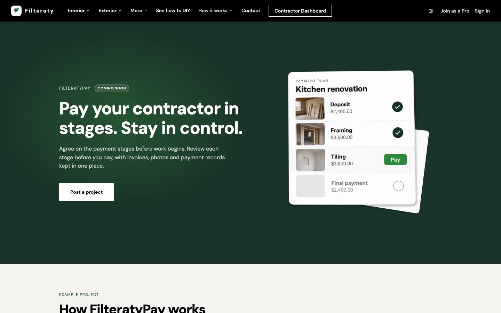
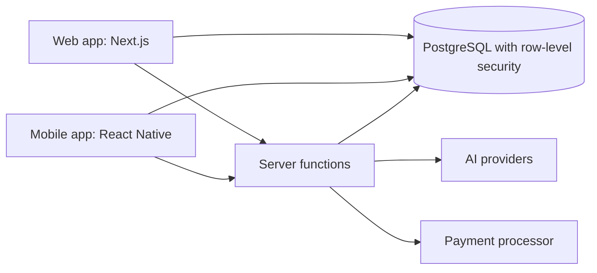
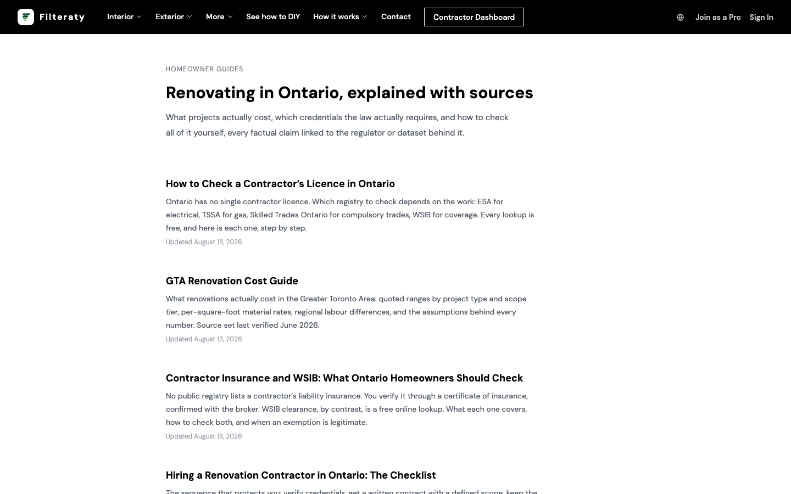

# Filteraty: founder case study

**A contractor referral and credential-transparency platform for the Greater Toronto Area and Nova Scotia.**
Live site: [filteraty.com](https://filteraty.com) · Founder: [Jesse (Siyuan) Xu](https://github.com/fclassjesse)

> This repository explains the business and product decisions. The source code, financial model and user data are
> private because Filteraty is an active company.

FilteratyPay is marked "coming soon" on the public site. The amounts shown are an example.

## The problem

Hiring a renovation contractor is an information problem. The contractor knows whether a licence is current and what
the insurance covers; the homeowner usually does not. The public evidence exists, but it is spread across several
regulators, and the rules differ by province.

## The solution

1. A homeowner describes a job, with text or photos.
2. Filteraty matches the job to screened contractors using explicit rules.
3. Each profile states what was checked, against which source, and when.
4. The homeowner and contractor sign and pay **directly with each other**.

Posting a project is free for homeowners.

## Decisions that shaped the business

| Question | Decision | Reason and trade-off |
|---|---|---|
| Open directory or matching? | Matching only | With few contractors at launch, a directory looks empty. The cost is less browsing for the homeowner. |
| Hold customers' money? | No | The contractor is the merchant and is paid directly. This keeps Filteraty out of the payment flow, but gives up escrow as a feature. |
| "Verified" badge or facts? | Dated facts | A vague badge asks for trust; a licence number and date can be checked. It takes more work to maintain. |
| One set of rules or one per province? | One per province | Licensing, workers' compensation and sales tax differ between Ontario and Nova Scotia. |
| Should AI make the final decision? | No | AI helps describe the job. Matching and safety limits are rules that can be tested. |

## Payment controls

FilteratyPay is designed for invoices and direct payment, and online payments are not yet open to the public. The
controls would be familiar to anyone who has worked with financial records:

- **Exact arithmetic.** Money is stored as whole cents and tax rates as basis points. There is no floating-point money.
- **Issued invoices do not change.** A mistake is corrected by voiding and replacing the invoice.
- **One source of truth.** A payment is confirmed only by a signed message from the payment processor, never by the
  user's browser.
- **No double counting.** Repeated processor messages are recognized and handled once.
- **Separation of duties.** AI may draft text, but it cannot issue an invoice or move money.

## Architecture

| | Snapshot, 24 November 2026 |
|---|---|
| Platforms | Web and mobile |
| Languages | English, French, Simplified Chinese |
| Launch markets | Greater Toronto Area, Nova Scotia |
| Trades covered | 24 (stated on the public site) |
| Commits | 341 (218 web, 123 mobile) since June 2026 |
| Automated checks, web | 1,930 passing, 9 skipped |

## My role

I founded Filteraty and lead its finance, product, growth and technology. I built the financial model and unit
economics, set the pricing and margin assumptions, and pitched the business within Saint Mary's University's
entrepreneurship ecosystem.

The software was developed with AI coding tools (Claude Code). I set the requirements, made the product and risk
decisions, and checked the results.

## What I learned

- **The payment structure is the business model.** Choosing not to hold funds affected regulation, risk, pricing and
  product design all at once.
- **Trust has a cost.** A claim that customers can check takes ongoing work to keep current.
- **Entering a second province was mostly a regulatory project.** The hard part was confirming which rules applied.

## Rights

© 2026 Filteraty Ltd. All rights reserved. Shared for portfolio purposes; this is not legal, tax or investment advice.
